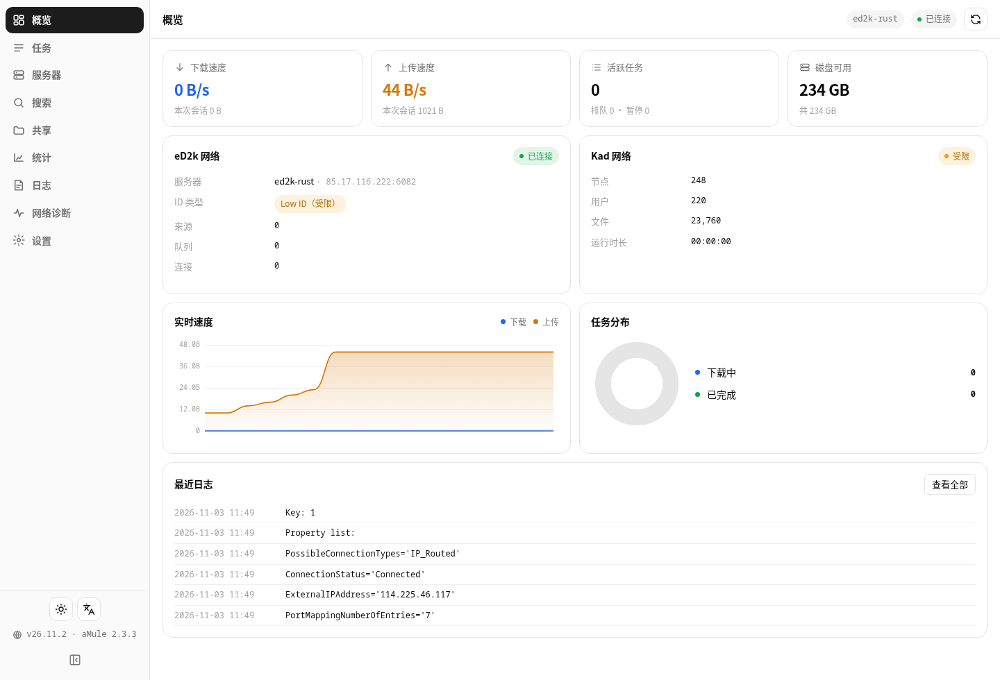
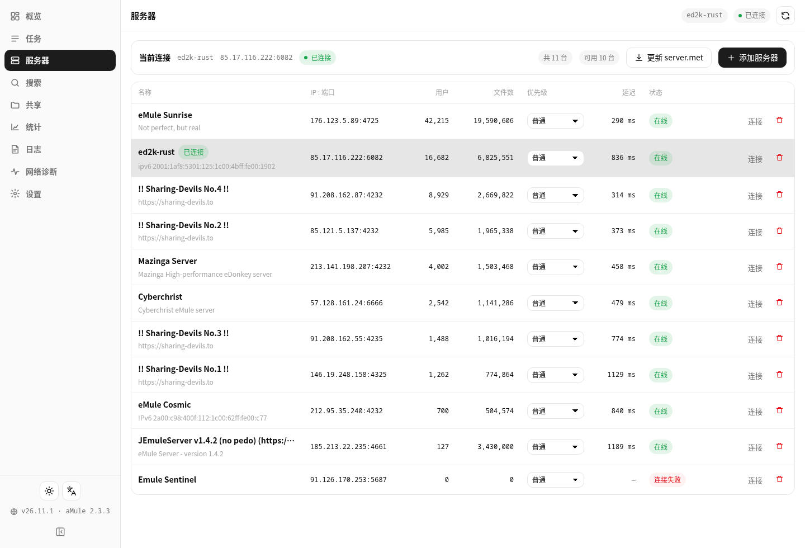
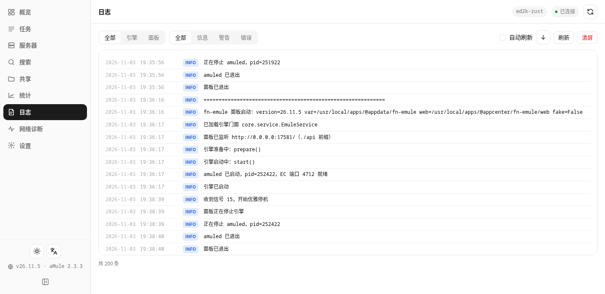
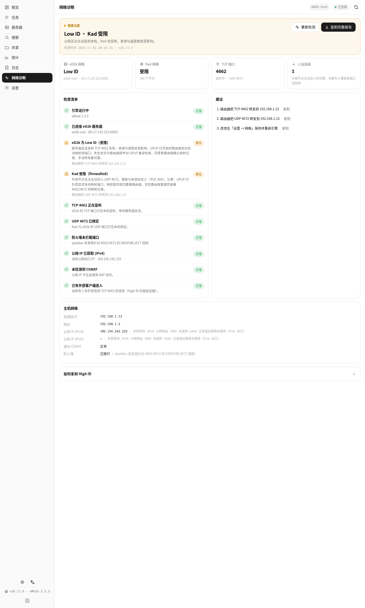
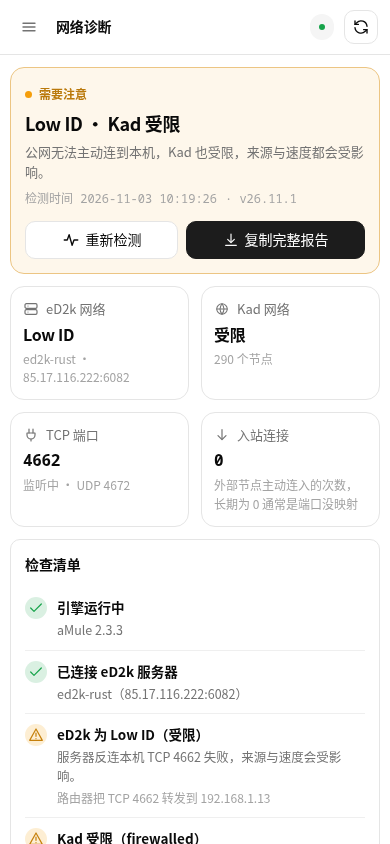
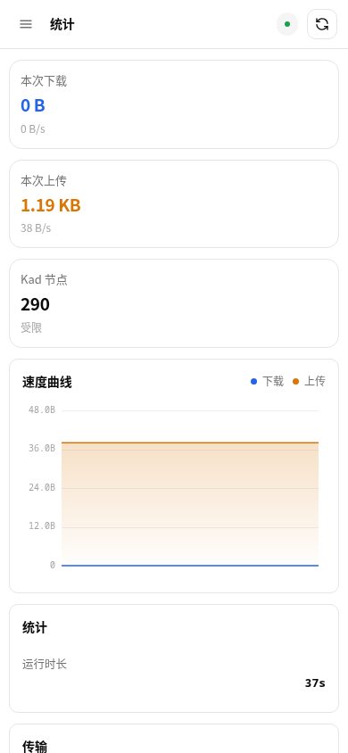
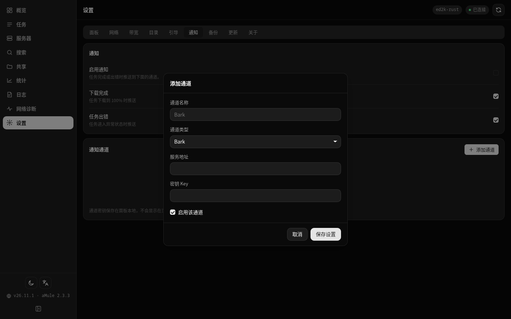
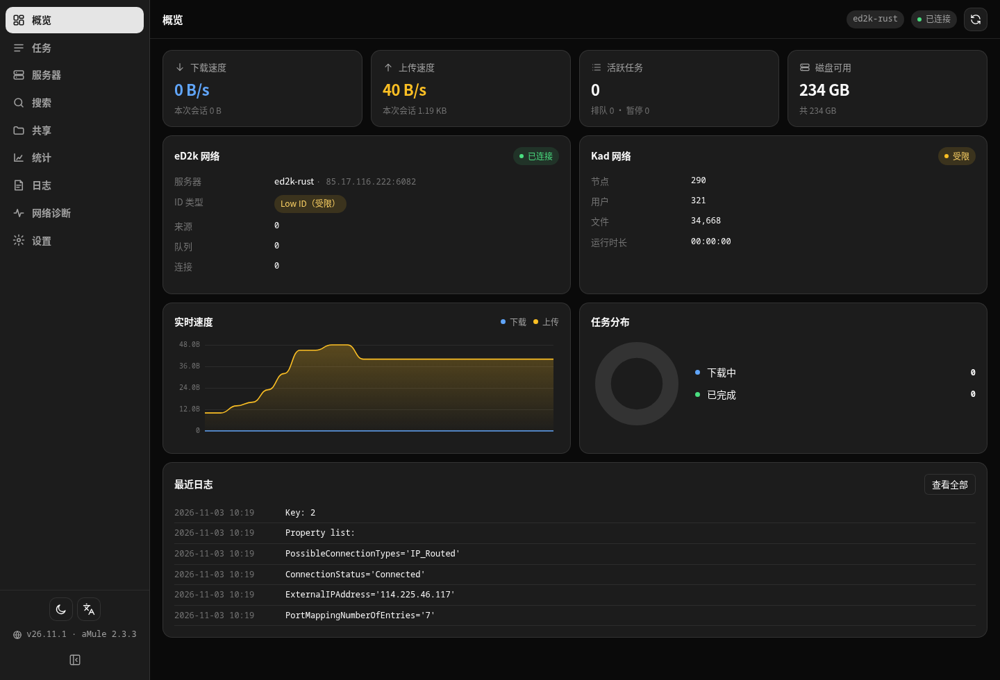

<div align="center">


# eMule 电驴（fn-emule）

**飞牛 fnOS 原生 eMule 应用** · 自带 aMule 引擎 · eD2k + Kad

纯 Python 3 标准库后端 · Vue 3 单页前端 · 内置引擎与依赖库 · 桌面端与手机端自适应

[功能](#功能一览) · [截图](#界面预览) · [安装](#安装) · [使用手册](#使用手册) · [常见问题](#常见问题) · [更新日志](CHANGELOG.md) · [开发说明](docs/DEVELOPMENT.md)

</div>

---

## 这是什么

eMule 电驴把 **aMule**（eMule 在 Linux 上的官方同源实现）做成了一个可以在飞牛 fnOS 桌面直接点开的原生应用（`.fpk`）：装完就有一个电驴客户端常驻在 NAS 上，白天黑夜挂着攒积分、下老资源、保源上传，你用浏览器或手机随时看进度。

它不是一个「换个皮的网页壳」，也不是 Docker 套壳：

- **引擎随包自带**：aMule 2.3.3 的 `amuled` 与它需要的 wxWidgets、crypto++、libupnp 等库全部打进 fpk（约 4 MB 压缩），装完不往系统里塞任何 apt 包，也不依赖你事先装过什么；
- **面板是一个本地服务**（默认端口 `17581`，特意挑的冷门 5 位端口，避开 8899/8080 这类高频端口）：浏览器只跟它通信，aMule 的 EC 管理端口只监听 `127.0.0.1`，凭据不出本机；
- **aMule 的配置由面板统一生成与托管**：端口、限速、目录、Nick、Kad 开关都在面板里改，改完自动重启引擎生效；
- **不需要 Python 包、Node、数据库**：后端只用系统自带的 Python 3 标准库（fnOS 自带 3.11），前端 Vue 3 也随包分发，离线可用。

适合这样的场景：NAS 上有大把闲置带宽和空间，想挂电驴（尤其是 eD2k/Kad 上那些只剩电驴才有人保源的老资源），但不想开一台 Windows 一直挂着 eMule。

---

## 功能一览

| 模块 | 能力 |
|---|---|
| **概览** | 下载 / 上传实时速度与曲线；eD2k 连接状态与当前服务器、High / Low ID 提示；Kad 连接状态、节点数、是否 firewalled；任务状态分布环图；队列与来源统计；磁盘余量 |
| **任务** | 下载 / 上传两个列表；名称搜索、状态筛选、多列排序；多选批量暂停 / 恢复 / 取消；ed2k 链接与 magnet 链接批量添加；单任务优先级（低 / 普通 / 高 / 自动） |
| **任务详情** | 文件信息（大小、已完成、进度、速度、剩余时间、队列位置）；**来源列表**（IP、客户端、版本、速度、排队名次与等待时间）；**分块图**（已完成 / 传输中 / 缺失，按 9.28 MB 块） |
| **服务器** | 服务器列表（名称、IP:端口、用户数、文件数、优先级、ping、失败次数）；一键连接 / 断开；手动增删；优先级调整；一键更新 server.met（面板自己下载，不让 aMule 碰 HTTP） |
| **搜索** | eD2k 服务器 / Kad / 全局三种搜索方式，按文件名等方法检索；结果带来源数、大小、类型，一键加入下载 |
| **共享** | 共享文件列表（大小、类型、请求数、已接受、已传输、路径）；重新载入共享目录 |
| **统计** | aMule 统计树按「传输 / 网络 / 客户端 / 共享」分组展示，常用指标中文化，手机端卡片式排版 |
| **网络诊断** | 一键检查：引擎状态、eD2k 是否 High ID、Kad 是否受限、TCP/UDP 端口监听与防火墙、内网/公网 IP 与运营商大内网（CGNAT）判定；逐条给出可直接照做的修复建议，可复制完整报告 |
| **日志** | 引擎日志与面板日志合并查看，按级别着色、按来源过滤、自动刷新 |
| **设置** | 网络（TCP / UDP / EC 端口、连接开关、Kad、Nick）、带宽（上下行限速、最大连接数、最大来源数）、目录（下载目录、临时目录、共享目录）、引导（server.met / nodes.dat 地址与自动更新）、通知、备份、更新检查 |
| **通知** | Bark / Server 酱 / PushPlus / WxPusher / 自定义 Webhook；下载完成、任务出错两类事件；每个渠道可单独测试；带投递记录 |
| **备份** | 面板配置 + aMule 配置 + server.met + nodes.dat 打包备份，保留 N 份，可一键恢复 |
| **版本更新** | 读取 GitHub 最新发布版本与当前版本比较，有新版本时提示并可下载安装包 |
| **移动端** | 抽屉侧栏、卡片式列表、全屏详情、无横向溢出，在飞牛手机 App 内嵌浏览器里同样顺手 |
| **深链** | 支持 `?view=` `?theme=` `?lang=` `?hash=` 参数，直接打开某个视图 / 某个任务 |

---

## 界面预览

> 截图全部来自测试机（fnOS 1.2.0800，aMule 2.3.3，真实电驴网络数据）。

| 概览 | 任务 |
|---|---|
|  |  |

| 服务器 | 统计 |
|---|---|
|  |  |

| 搜索 | 共享 |
|---|---|
|  |  |

| 日志 | 设置 |
|---|---|
|  |  |

| 网络诊断 | 诊断（手机端） |
|---|---|
|  |  |

| 统计（手机端） | 通知渠道（9 种） |
|---|---|
|  |  |

| 深色主题 | 手机端（390px） |
|---|---|
|  |  |

---

## 安装

### 前置条件

- 飞牛 fnOS **1.2.0600 及以上**，**x86_64 或 ARM** 设备都能用同一个安装包（包里同时带两套引擎）；
- 一个可写的存储卷（应用默认装在系统卷，下载目录落在应用共享文件夹里，可在设置里改到任意卷）；
- 想要更快，建议在路由器上把 **TCP 4662 / UDP 4672** 转发到 NAS（可选，不转发也能用，只是 Low ID）。

### 方式一：应用中心手动安装（推荐）

> 最新安装包见 **GitHub Releases**：<https://github.com/Smi13zZ/fn-emule/releases/latest>
> （每次推 `v*` 标签，Actions 会自动在 Debian 12 容器里构建并发布，产物是单包 `-fnos-all.fpk`）

1. 下载 `fn-emule-26.11.4-fnos-all.fpk`（**一个包，x86_64 与 ARM 通用**，不用挑架构）；
2. 飞牛 fnOS → **应用中心 → 手动安装** → 选择该文件；
3. 安装向导里确认**面板端口**（默认 17581）与**电驴网络端口**（默认 TCP 4662 / UDP 4672）；
4. 装完桌面出现「eMule 电驴」图标，点开即用。

### 方式二：命令行安装

```bash
# 把 fpk 传到设备上后执行（需要 sudo）
sudo appcenter-cli install-fpk /path/to/fn-emule-26.11.4-fnos-x86.fpk
sudo appcenter-cli start fn-emule        # 启动
sudo appcenter-cli status --appname fn-emule
```

### 升级

- **应用中心里升级（推荐）**：把新版本的 `.fpk` 拿到设备上，应用中心 → 手动安装 → 选择新包，会走 fnOS 的升级流程（自动停服务 → 换包 → 起服务，配置与下载进度都保留）。
- **命令行升级**：`appcenter-cli install-fpk` 对“已安装的应用”是**空操作**（只输出 installed 不换包），命令行升级需要先 `sudo appcenter-cli uninstall fn-emule` 再安装新包——注意卸载会清掉 `var` 里的面板配置（下载文件不受影响）。

### 安装位置

| 用途 | 路径 |
|---|---|
| 程序目录 | `/var/apps/fn-emule/target`（→ `/usr/local/apps/@appcenter/fn-emule`） |
| 面板配置与引擎配置 | `/var/apps/fn-emule/var`（→ `/usr/local/apps/@appdata/fn-emule`） |
| 下载完成目录 | `/vol1/@appshare/fn-emule/Incoming`（文件管理里显示为「fn-emule」共享文件夹） |
| 临时分块目录 | `/vol1/@appshare/fn-emule/Temp` |
| 备份 | `/var/apps/fn-emule/var/backups` |

---

## 使用手册

### 0. 第一次打开

面板会自动生成一份 aMule 配置并拉起引擎，同时从 `upd.emule-security.org` 拉取服务器列表（server.met）与 Kad 节点（nodes.dat）——这两步由面板自己用 Python 完成，不经过 aMule 的 HTTP 客户端。

概览页顶部会显示三件事：

- **eD2k**：是否连上服务器、当前服务器名与 IP、**High ID / Low ID**；
- **Kad**：是否连接、节点数、是否 firewalled；
- **速度**：当前上下行与本次会话累计。

> **Low ID 是什么？** 电驴网络里，能被别人主动连进来的客户端拿到 High ID，反之是 Low ID。Low ID 只能连 Low ID 的对方，来源数量会少一截，速度也慢。把路由器上的 TCP 4662 / UDP 4672 转发到 NAS 就能拿到 High ID（部分路由器还需要放行 UDP 4672 的 Kad 流量）。

### 1. 添加任务

任务页右上角「添加」支持两种链接：

- `ed2k://|file|文件名|大小|哈希|/`
- `magnet:?xt=urn:ed2k:<哈希>&dn=<文件名>`

可以一次粘贴多行，面板逐条提交并告诉你哪几条成功、哪几条重复或被忽略。

### 2. 任务页

- 顶部四个数字：进行中 / 排队 / 暂停 / 已完成；
- 表格列：名称（带进度条）、大小、进度、速度、来源（已连接 / 总数）、优先级、剩余时间、状态；
- 支持状态筛选、名称搜索、按速度/进度/大小排序；
- 勾选多行后可以批量暂停、恢复、取消；
- 点任意一行打开右侧抽屉：文件信息、来源列表、分块图。分块图里深色是已完成，浅色是缺失，正在传输的块会高亮。

### 3. 服务器页

- 顶部是当前连接的服务器与连接状态，可一键断开 / 重连；
- 列表显示每台服务器的用户数、文件数、优先级、ping 与失败次数；
- 「更新列表」会从设置里配置的 server.met 地址下载最新服务器列表并导入。

### 4. 搜索页

选择范围（服务器 / Kad / 全局）与方式（文件名等），输入关键词后开始搜索。结果实时出现，每行可以直接「下载」。搜索本身走 Kad 与服务器，速度取决于网络状况，通常 10–60 秒内出结果。

> 搜不到东西的常见原因：没连上服务器、Kad 没连上、关键词太具体。可以先用宽泛的关键词试试。

### 5. 共享页

显示当前正在共享的文件（Incoming 目录下的完整文件 + 设置里额外添加的共享目录）。电驴网络靠「我上传你、你上传我」运转，**保源上传是电驴速度的根本**，所以别把上传限速设成 0 以外的很小值。

### 6. 统计与日志

统计页是 aMule 自己的统计树，按组展开；日志页把引擎日志与面板日志合并，可按来源过滤，排查「为什么没速度」时先看这里。

### 6.1 网络诊断

侧栏「网络诊断」页会一次性把「为什么慢」查清楚：

- **结论卡**：直接告诉你现在是 High ID 还是 Low ID、Kad 是否受限；
- **关键指标**：eD2k 当前服务器、Kad 节点数、TCP/UDP 端口是否在监听、最近有没有外部连进来；
- **检查清单**：引擎、eD2k 连接、High/Low ID、Kad、TCP 监听、UDP 绑定、防火墙、公网 IP、CGNAT、入站连接，逐项三色标记；
- **建议**：需要做什么（在哪台设备上转发哪个端口）一条条列出来，可以单条复制或一键复制完整报告。

> 典型结论：`Low ID · Kad 受限` → 建议里会写「路由器把 TCP 4662 转发到 192.168.1.x」「路由器把 UDP 4672 转发到 192.168.1.x」。如果检测到运营商大内网（CGNAT），会明确告诉你这种情况下拿不到 High ID 属正常现象。

### 7. 设置页

| 分组 | 说明 |
|---|---|
| 面板 | 面板端口（改动会重启面板服务）、主题、语言 |
| 网络 | eD2k TCP / UDP 端口、EC 端口、自动连接、eD2k / Kad 开关、Nick |
| 带宽 | 下载限速、上传限速（0 = 不限）、最大连接数、每文件最大来源数 |
| 目录 | 下载完成目录、临时目录、共享目录（可添加多个卷上的目录） |
| 引导 | server.met / nodes.dat 地址、自动更新周期、立即更新 |
| 通知 | 渠道与事件开关、测试发送 |
| 备份 | 立即备份、备份列表、恢复、删除 |
| 更新 | 检查更新、下载安装包 |
| 关于 | 版本、引擎版本、许可与源码地址 |

改「网络 / 带宽 / 目录」保存后引擎会重启（几秒），正在下载的任务会断点续传，不会丢进度。

### 8. 通知

支持 Bark、Server 酱、PushPlus、WxPusher 与自定义 Webhook。配置好渠道后，任务下载完成或出错时会推送一条消息；「投递记录」里能看到每次推送的成功/失败与原因。

### 9. 备份与恢复

备份会打包：面板配置（`settings.json`）、aMule 配置（`amule.conf`）、服务器列表（`server.met`）、Kad 节点（`nodes.dat`）。**不会**打包正在下载的分块文件与已完成的文件（那些本来就在共享文件夹里）。

---

## 手机端

飞牛手机 App 里点开应用图标即可。移动端是同一套页面的自适应布局：侧栏变抽屉、表格变卡片、任务详情全屏、按钮加大触摸热区。也可以直接用手机浏览器访问 `http://NAS-IP:17581`。

---

## 深链参数

| 参数 | 说明 | 示例 |
|---|---|---|
| `view` | 直接打开某个视图 | `?view=tasks`（dash / tasks / servers / search / shared / stats / logs / settings） |
| `theme` | 强制主题 | `?theme=dark` / `light` / `auto` |
| `lang` | 强制语言 | `?lang=en` |
| `hash` | 打开任务页并选中某个任务（当前版本只做定位，不自动开抽屉） | `?view=tasks&hash=A1B2C3...` |

---

## 从源码构建 fpk

### 目录

```
src/emule/       fpk 源码根（manifest / cmd / config / wizard / app）
tools/           构建、校验、取运行时、验收脚本
docs/            契约与开发说明
research/        aMule EC 协议源码（只读参考）
```

### 构建

打包必须在 Linux 上做（fnpack 在 Windows 上会丢可执行位，fnOS 直接拒绝安装），脚本会把源码送到 NAS 上打：

```bash
python tools/build_fpk.py             # 打出单包 fn-emule-<ver>-fnos-all.fpk（x86 + ARM 通吃）
python tools/build_fpk.py --install   # 打完顺手装到测试机
```

首次构建会自动在设备上执行 `tools/prepare_runtime.sh`：从 Debian 官方包抽出 `amuled` 与它依赖的库（wxWidgets / crypto++ / libupnp / libixml / pcre2），排除 glibc、libstdc++、zlib 这些基础库。

### 验收

```bash
python3 tools/verify_fpk.py output/fn-emule-26.11.4-fnos-x86.fpk   # 结构 + 权限
python3 tools/smoke_test.py --base http://127.0.0.1:17581           # 装好后跑接口验收
```

### GitHub Actions

推 `v*` 标签会构建并发布 Release（版本号以 `src/emule/manifest` 为准）。工作流见 `.github/workflows/build-fpk.yml`。

---

## 常见问题

**Q：装完打开是空白 / 502？**
应用中心里把应用重启一次；面板进程会在 `var/panel.log` 里写原因。最常见的两个原因：面板端口被别的应用占了、Python 解释器路径异常。

**Q：一直 Low ID 怎么办？**
把路由器上 TCP 4662 与 UDP 4672 转发到 NAS 的内网 IP。如果 NAS 前面还有一层 NAT（光猫桥接不完整、运营商大内网），那基本拿不到 High ID，属于正常现象，能下但来源会少。

**Q：Kad 显示 firewalled？**
UDP 4672 没有对外可达。转发 UDP 端口后重启引擎即可。Kad 即便 firewalled 也仍然能工作，只是节点发现效率低一些。

**Q：为什么下载很慢，只有几十 KB/s？**
电驴的核心是排队与积分：新客户端、新文件、来源少的老资源都会慢。给它挂几天、保持上传、多连几台服务器（或依赖 Kad），速度会慢慢上来。另外「上传限速」不要设太小，上传少会拖慢下载排队。

**Q：下载好的文件在哪？**
默认在文件管理的「fn-emule」共享文件夹 → `Incoming`。想放到别的卷，在设置 → 目录里改。

**Q：临时文件 Temp 能删吗？**
不能。里面是正在下载的分块，删了任务就得重新下。

**Q：能和别的下载器（qBittorrent）同时跑吗？**
可以，端口不冲突。

**Q：卸载会删掉下载的文件吗？**
不会。卸载只清程序与配置（`var` 里的配置目录会保留，重装可续用），共享文件夹里的文件不受影响。

**Q：为什么面板要 root 运行？**
电驴需要绑定 4662/4672 端口并写入共享目录，fnOS 的应用安装类型是 `install_type=root`（与 qBpanel 等应用一致）。面板本身不对外暴露管理接口，EC 端口只监听 127.0.0.1。

---

## 安全说明

- aMule 的 EC 管理端口**只监听 `127.0.0.1`**，密码随机生成并存在 `var/settings.json`，浏览器拿不到；
- 面板不做任何外部上报；通知推送只在你配置了渠道后才会发出；
- 更新检查只访问 GitHub Releases API；
- 面板不提供任意文件读写接口，备份恢复只允许 `var/backups` 下的文件；
- 安装包里的 aMule 是 Debian 官方二进制，未做修改，许可证见 `THIRD_PARTY.md`。

---

## 已知限制

- 一个包同时支持 x86_64 与 ARM（内置两套引擎）；其它架构（如 RISC-V）不提供；
- aMule 2.3.3 是 eMule 0.50a 时代的同源实现，不支持 eMule 社区后来的一些私有扩展；
- 搜索结果的「类型/扩展名」来自文件名推断，个别文件可能不准；
- 面板不提供改名、移动已完成文件的操作（做这些请用文件管理，避免与引擎抢文件）。

---

## 许可

本应用（面板与打包脚本）使用 MIT 许可，见 [LICENSE](LICENSE)。

随包分发的 aMule 2.3.3 使用 GPL-2.0-or-later 许可，二进制来自 Debian 官方仓库，未做修改；源码见 <https://github.com/amule-project/amule>。其它随包库的许可见 [THIRD_PARTY.md](THIRD_PARTY.md)。
