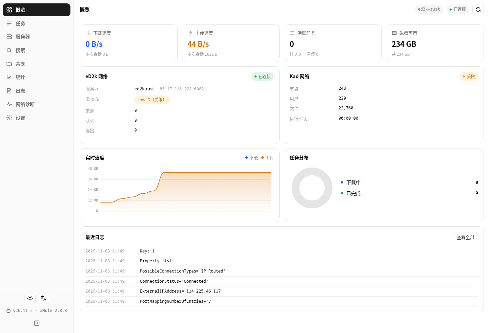
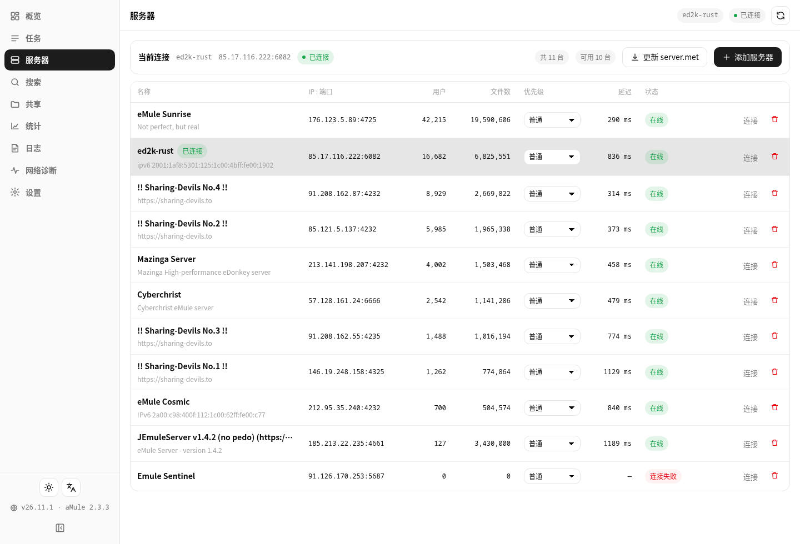
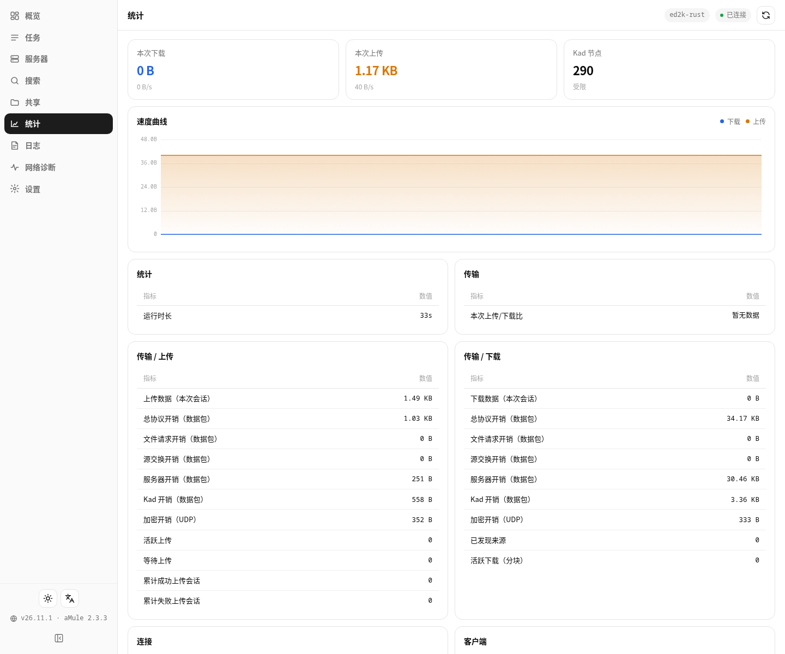
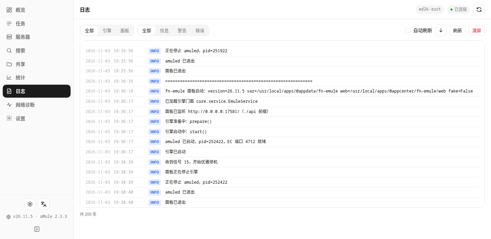
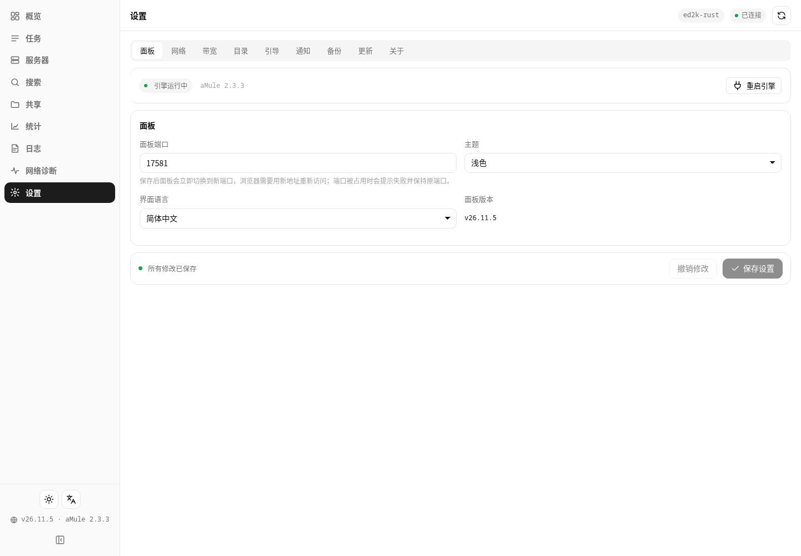
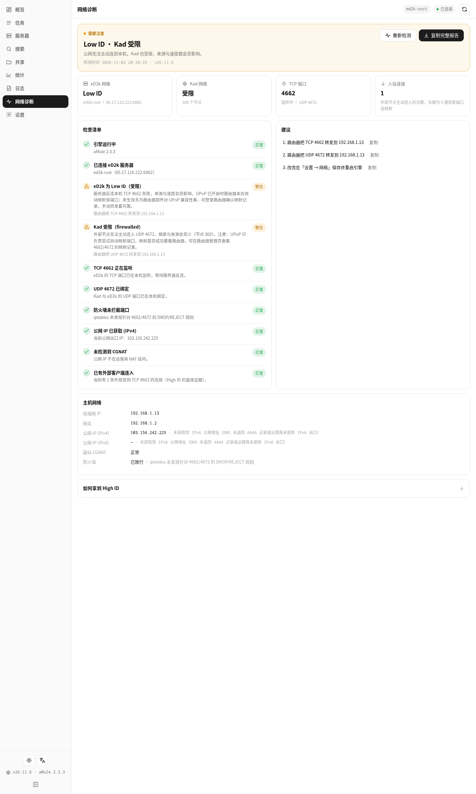
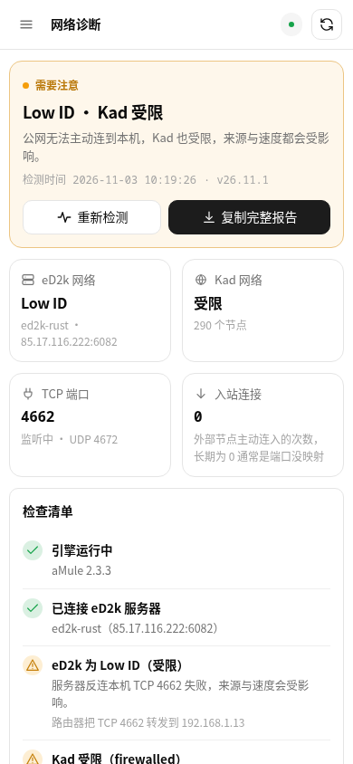
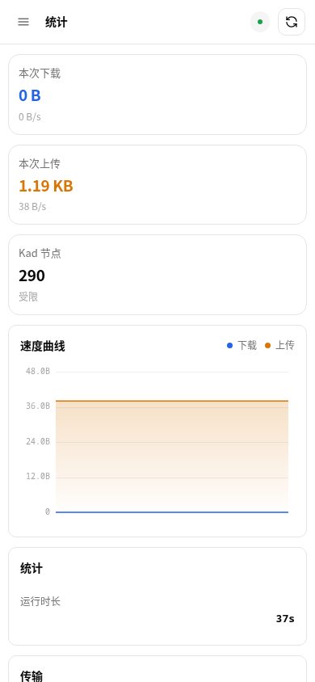
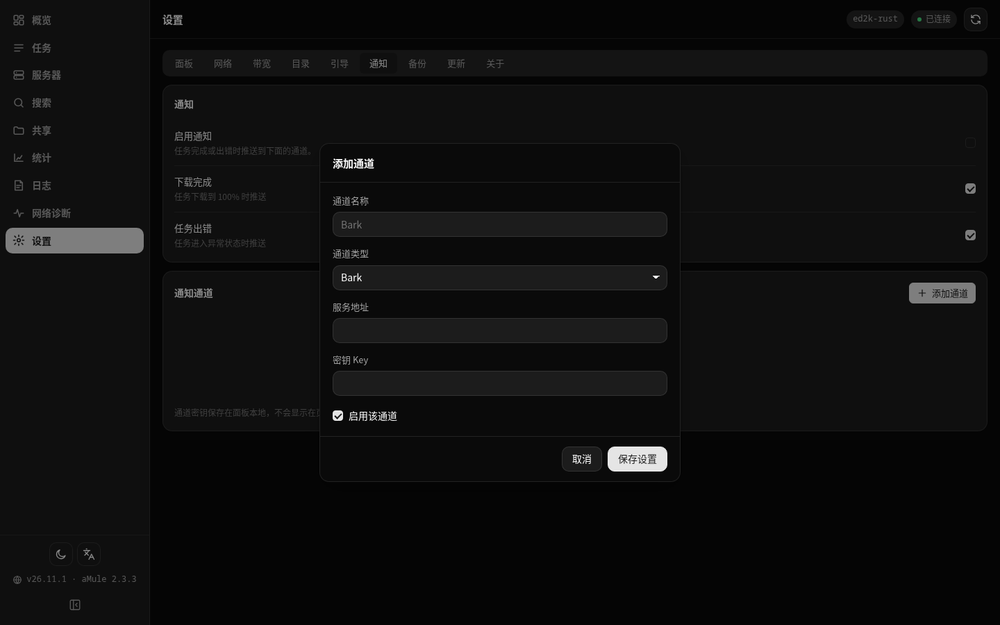
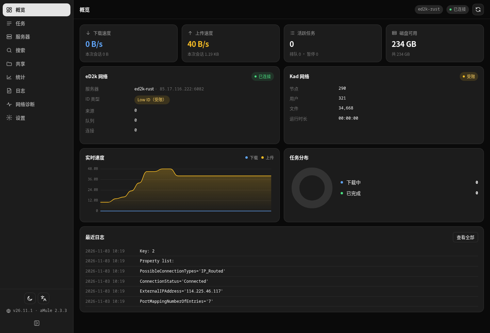

<div align="center">


# eMule (fn-emule)

**A native eMule app for Feiniu fnOS** · Bundled aMule engine · eD2k + Kad

Python 3 standard-library backend · Vue 3 single-page frontend · Engine and shared libraries bundled · Responsive on desktop and mobile

[Features](#features) · [Screenshots](#screenshots) · [Installation](#installation) · [User guide](#user-guide) · [FAQ](#faq) · [Changelog](CHANGELOG.md) · [Development notes](docs/DEVELOPMENT.md) · [中文说明](README.md)

</div>

---

## What is this

eMule (fn-emule) turns **aMule** — the official eMule-compatible implementation on Linux — into a native app you can open straight from the Feiniu fnOS desktop (`.fpk`). After installing it you have an eMule client running on your NAS around the clock: collecting credits, pulling old eD2k/Kad releases and seeding them back, while you watch progress from a browser or your phone.

It is not a re-skinned web UI, and it is not Docker in disguise:

- **The engine ships inside the package**: aMule 2.3.3's `amuled` plus the wxWidgets, crypto++, libupnp and pcre2 libraries it needs are bundled into the fpk (~8 MB), so nothing is installed via apt and nothing has to be present beforehand;
- **The panel is a local service** (default port `17581` — a deliberately uncommon 5-digit port that avoids popular ones like 8899/8080): the browser only talks to it, aMule's EC management port listens on `127.0.0.1` only, and credentials never leave the box;
- **The panel owns aMule's configuration**: ports, speed limits, folders, nick and the Kad toggle are all edited in the panel, which regenerates `amule.conf` and restarts the engine for you;
- **No Python packages, no Node, no database**: the backend only uses the system Python 3 standard library (fnOS ships 3.11) and Vue 3 is served from the package. Works offline.

Typical use case: your NAS has idle bandwidth and disk space, and you want to keep eMule running for old eD2k/Kad material that nobody seeds any more — without leaving a Windows box switched on.

---

## Features

| Module | What it does |
|---|---|
| **Overview** | Live download/upload rates and sparkline; eD2k connection state, current server and High/Low ID; Kad state, node count and firewalled flag; task-state donut; queue and source counters; free disk space |
| **Transfers** | Separate download and upload lists; name search, state filter, multi-column sort; multi-select pause/resume/cancel; batch add via ed2k and magnet links; per-task priority (low/normal/high/auto) |
| **Transfer details** | File info (size, completed, progress, speed, ETA, queue position); **source list** (IP, client, version, speed, queue rank and wait time); **chunk map** (done / transferring / missing, in 9.28 MB parts) |
| **Servers** | Server list (name, IP:port, users, files, priority, ping, failures); connect/disconnect; add/remove; priority switching; one-click server.met update (the panel downloads it itself, so aMule never touches HTTP) |
| **Search** | Server, Kad or global search by filename and other methods; results show sources, size and type and can be queued with one click |
| **Shared files** | Shared file list (size, type, requests, accepted, transferred, path); reload shared folders |
| **Statistics** | aMule's statistics tree grouped as Transfer / Network / Clients / Shared, with human-readable labels and a card layout on mobile |
| **Network diagnostics** | One-shot check: engine state, eD2k High/Low ID, Kad firewalled, TCP/UDP listeners and firewall, LAN/public IP and CGNAT detection — plus copy-pasteable fix suggestions and a full report |
| **Logs** | Engine and panel logs merged, coloured by level, filtered by source, auto-refresh |
| **Settings** | Network (TCP/UDP/EC ports, autoconnect, Kad, nick), bandwidth (up/down limits, max connections, max sources), folders (incoming, temp, shared), bootstrap (server.met / nodes.dat URLs and refresh), notifications, backups, update check |
| **Notifications** | Bark, ServerChan, PushPlus, WxPusher and custom Webhook (plus Telegram, WeCom bot, DingTalk bot, Slack); events on download completion and task errors; per-channel test; delivery history |
| **Backup** | Bundles panel settings + aMule config + server.met + nodes.dat, keeps N copies, one-click restore |
| **Updates** | Compares the latest GitHub release with the running version and offers the package for download |
| **Mobile** | Drawer sidebar, card lists, full-screen details, no horizontal overflow — works inside the Feiniu mobile app webview |
| **Deep links** | `?view=`, `?theme=`, `?lang=`, `?hash=` to open a view or a task directly |

---

## Screenshots

> All screenshots come from a test device (fnOS 1.2.0800, aMule 2.3.3) with real eD2k/Kad traffic.

| Overview | Transfers |
|---|---|
|  |  |

| Servers | Statistics |
|---|---|
|  |  |

| Search | Shared files |
|---|---|
|  |  |

| Logs | Settings |
|---|---|
|  |  |

| Network diagnostics | Diagnostics (mobile) |
|---|---|
|  |  |

| Statistics (mobile) | Notification channels (9) |
|---|---|
|  |  |

| Dark theme | Mobile (390px) |
|---|---|
|  |  |

---

## Installation

### Prerequisites

- Feiniu fnOS **1.2.0600 or newer**; the **same package works on x86_64 and ARM** (both engines are inside);
- a writable storage volume (the app lives on the system volume, downloads land in the app's shared folder and can be pointed at any volume in Settings);
- optionally forward **TCP 4662 / UDP 4672** to the NAS on your router for a High ID (not required — it still works, just with Low ID).

### Option 1 — App Center, manual install (recommended)

> Latest package: **GitHub Releases** <https://github.com/Smi13zZ/fn-emule/releases/latest>
> (pushing a `v*` tag makes Actions build it inside a Debian 12 container and publish a single `-fnos-all.fpk`)

1. Download `fn-emule-26.11.4-fnos-all.fpk` (one file for x86_64 and ARM — no architecture picking);
2. fnOS → **App Center → Manual install** → choose the file;
3. In the wizard confirm the **panel port** (default 17581) and the **eD2k ports** (TCP 4662 / UDP 4672);
4. An "eMule" icon appears on the desktop — open it and you are done.

### Option 2 — command line

```bash
# copy the fpk to the device, then (needs sudo)
sudo appcenter-cli install-fpk /path/to/fn-emule-26.11.4-fnos-all.fpk
sudo appcenter-cli start fn-emule        # start
sudo appcenter-cli status --appname fn-emule
```

### Upgrading

- **Through App Center (recommended)**: drop the new `.fpk` on the device, App Center → Manual install → pick it. fnOS runs its upgrade flow (stop → swap → start) and keeps settings and download progress.
- **Through the CLI**: `appcenter-cli install-fpk` is a **no-op for an already-installed app** (it only prints "is installed"). Run `sudo appcenter-cli uninstall fn-emule` first — note that uninstalling wipes the panel settings under `var` (downloaded files are untouched).

### Where things live

| Purpose | Path |
|---|---|
| Program files | `/var/apps/fn-emule/target` (→ `/usr/local/apps/@appcenter/fn-emule`) |
| Panel + engine configuration | `/var/apps/fn-emule/var` (→ `/usr/local/apps/@appdata/fn-emule`) |
| Completed downloads | `/vol1/@appshare/fn-emule/Incoming` (shown as the "fn-emule" shared folder) |
| Part files | `/vol1/@appshare/fn-emule/Temp` |
| Backups | `/var/apps/fn-emule/var/backups` |

---

## User guide

### 0. First launch

The panel generates a complete aMule configuration and starts the engine, then fetches the server list (`server.met`) and Kad bootstrap nodes (`nodes.dat`) from `upd.emule-security.org`. Both downloads are performed by the panel in Python — aMule's own HTTP client is deliberately never used.

The overview page answers three questions:

- **eD2k**: connected? which server? **High ID or Low ID**?
- **Kad**: connected? how many nodes? firewalled?
- **Speed**: current up/down plus session totals.

> **What is Low ID?** On the eD2k network, a client that others can connect back to gets a High ID; otherwise it gets a Low ID. Low IDs can only reach other Low IDs, which cuts the number of usable sources and slows everything down. Forward TCP 4662 / UDP 4672 to the NAS to get a High ID (some routers also need UDP 4672 for Kad).

### 1. Adding transfers

The **Add** button accepts:

- `ed2k://|file|name|size|hash|/`
- `magnet:?xt=urn:ed2k:<hash>&dn=<name>`

You can paste many lines at once; the panel submits them one by one and reports which succeeded, which were duplicates and which were rejected.

### 2. Transfers page

- Four counters at the top: active / queued / paused / completed;
- Columns: name (with progress bar), size, progress, speed, sources (connected / total), priority, ETA, state;
- State filter, name search, sort by speed/progress/size;
- Select rows to pause, resume or cancel in bulk;
- Click any row to open the drawer: file info, source list and chunk map. In the chunk map dark means done, light means missing, and active chunks are highlighted.

### 3. Servers page

- The current server and connection state sit at the top with disconnect/reconnect;
- The list shows users, files, priority, ping and failure count per server;
- **Update list** downloads the server.met URL from Settings and imports it.

### 4. Search page

Pick a scope (server / Kad / global) and a method (filename and friends), type a keyword and search. Results stream in and each row can be queued directly. Searches go through Kad and the servers, so speed depends on the network — usually results within 10–60 seconds.

> Nothing found? Usually no server connection, Kad not connected, or a keyword that is too specific. Try something broader first.

### 5. Shared files page

Lists what you are sharing (complete files in `Incoming` plus any extra folders configured in Settings). eD2k runs on reciprocity — **seeding is what makes your downloads fast**, so do not set the upload limit to something tiny.

### 6. Statistics and logs

The statistics page is aMule's own tree, grouped; the log page merges engine and panel logs with a source filter — the first place to look when "it is slow".

### 6.1 Network diagnostics

The **Network diagnostics** page answers "why is it slow" in one shot:

- **Verdict card**: High ID or Low ID, Kad firewalled or not;
- **Key metrics**: current eD2k server, Kad node count, TCP/UDP listener state, inbound connections;
- **Checklist**: engine, eD2k connection, High/Low ID, Kad, TCP listener, UDP bind, firewall, public IP, CGNAT, inbound connections — each marked green/amber/red;
- **Suggestions**: exactly what to do (which port to forward on which device), copyable one by one or as a full report.

> A typical verdict is `Low ID · Kad firewalled`, with suggestions such as "forward TCP 4662 to 192.168.1.x" and "forward UDP 4672 to 192.168.1.x". If a carrier-grade NAT (CGNAT) is detected, the page tells you that a High ID is simply not achievable in that case.

### 7. Settings page

| Group | Contents |
|---|---|
| Panel | Panel port (switching restarts the listener), theme, language |
| Network | eD2k TCP/UDP ports, EC port, autoconnect, eD2k/Kad toggles, nick |
| Bandwidth | Download limit, upload limit (0 = unlimited), max connections, max sources per file |
| Folders | Incoming folder, temp folder, shared folders (any volume) |
| Bootstrap | server.met / nodes.dat URLs, refresh interval, refresh now |
| Notifications | Channels, event toggles, test send |
| Backup | Back up now, list, restore, delete |
| Update | Check for updates, download the package |
| About | Version, engine version, license and source links |

Saving changes under Network / Bandwidth / Folders restarts the engine (a few seconds); running downloads resume from where they were.

### 8. Notifications

Bark, ServerChan, PushPlus, WxPusher and custom Webhook (plus Telegram, WeCom bot, DingTalk bot and Slack). Once a channel is configured you get a message when a download completes or a task errors; the delivery log shows success/failure and the reason for each attempt.

### 9. Backup and restore

A backup bundles panel settings (`settings.json`), aMule configuration (`amule.conf`), the server list (`server.met`) and Kad nodes (`nodes.dat`). It deliberately **does not** include part files or completed downloads — those already live in the shared folder.

---

## Mobile

Open the app icon inside the Feiniu mobile app. It is the same UI in a responsive layout: drawer sidebar, card lists, full-screen details, larger touch targets. You can also point a mobile browser at `http://NAS-IP:17581`.

---

## Deep links

| Parameter | Meaning | Example |
|---|---|---|
| `view` | Open a specific view | `?view=tasks` (dash / tasks / servers / search / shared / stats / logs / settings / diagnostics) |
| `theme` | Force a theme | `?theme=dark` / `light` / `auto` |
| `lang` | Force a language | `?lang=en` |
| `hash` | Open the transfers view and select a task (highlight only, the drawer does not auto-open) | `?view=tasks&hash=A1B2C3...` |

---

## Building the fpk from source

### Layout

```
src/emule/       fpk source root (manifest / cmd / config / wizard / app)
tools/           build, verify, runtime extraction and smoke-test scripts
docs/            contract and development notes
research/        aMule EC protocol sources (read-only reference)
```

### Build

Packaging has to happen on Linux (fnpack on Windows loses executable bits and fnOS refuses the package). The script ships the sources to a NAS and builds there:

```bash
python tools/build_fpk.py             # produce the single fn-emule-<ver>-fnos-all.fpk (x86 + ARM)
python tools/build_fpk.py --install   # build, then install onto the test device
```

The first run executes `tools/prepare_runtime.sh` on the device, which extracts `amuled` and its libraries (wxWidgets / crypto++ / libupnp / libixml / pcre2) from Debian packages, excluding base libraries such as glibc, libstdc++ and zlib. The ARM engine is resolved statically by `tools/resolve_libs.py` (an x86 build host cannot execute aarch64 binaries).

### Verification

```bash
python3 tools/verify_fpk.py output/fn-emule-26.11.4-fnos-all.fpk   # structure, permissions, ELF arch
python3 tools/smoke_test.py --base http://127.0.0.1:17581         # 26 API checks on a live install
```

### GitHub Actions

Pushing a `v*` tag builds and publishes a Release (the version comes from `src/emule/manifest`). See `.github/workflows/build-fpk.yml`.

---

## FAQ

**Blank page or 502 after install?**
Restart the app in App Center; the panel writes the reason to `var/panel.log`. The two usual causes are a port already taken by another app and an unexpected Python path.

**Always Low ID?**
Forward TCP 4662 and UDP 4672 to the NAS' LAN address. If there is another NAT in front (half-bridged ONT, carrier NAT), a High ID is not achievable — the app still works, just with fewer sources.

**Kad shows firewalled?**
UDP 4672 is not reachable from outside. Forward it and restart the engine. Kad keeps working while firewalled, it is just less efficient at discovering nodes.

**Why is the download only a few tens of KB/s?**
eD2k is all about queueing and credits: new clients, new files and rare releases start slowly. Leave it running for a few days, keep uploading and connect to several servers (or rely on Kad). Also keep the upload limit reasonable — uploading little makes your download queue longer.

**Where are finished downloads?**
By default in the "fn-emule" shared folder → `Incoming`. Change it under Settings → Folders to use another volume.

**Can I delete the Temp folder?**
No — it holds chunk files of running downloads; deleting it forces a re-download.

**Can it run next to another downloader such as qBittorrent?**
Yes, the ports do not clash.

**Does uninstalling delete my files?**
No. Uninstalling removes the program and (depending on the path) the panel settings under `var`; files in the shared folder are untouched.

**Why does the panel run as root?**
eD2k needs to bind 4662/4672 and write into the shared folder, and fnOS apps use `install_type=root` (same as qBpanel). The panel exposes no remote management API and the EC port listens on 127.0.0.1 only.

---

## Security notes

- aMule's EC management port **listens on `127.0.0.1` only**; the password is generated randomly and stored in `var/settings.json`, never handed to the browser;
- the panel reports nothing externally; notifications are only pushed after you configure a channel;
- the update check only calls the GitHub Releases API;
- there is no generic file read/write API, and restore only accepts files under `var/backups`;
- the bundled aMule is an unmodified Debian binary; see `THIRD_PARTY.md` for licenses.

---

## Known limitations

- one package covers x86_64 and ARM (both engines are bundled); other architectures (e.g. RISC-V) are not supported;
- aMule 2.3.3 is contemporary with eMule 0.50a and does not implement some later community extensions;
- the "type/extension" of search results is inferred from the filename and may occasionally be wrong;
- the panel does not rename or move completed files (use the file manager so the engine and you do not fight over files).

---

## License

The app (panel and packaging scripts) is MIT licensed — see [LICENSE](LICENSE).

The bundled aMule 2.3.3 is GPL-2.0-or-later, taken unmodified from the official Debian repositories; sources at <https://github.com/amule-project/amule>. Licenses of the other bundled libraries are listed in [THIRD_PARTY.md](THIRD_PARTY.md).
