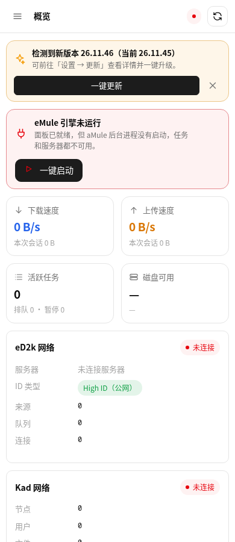
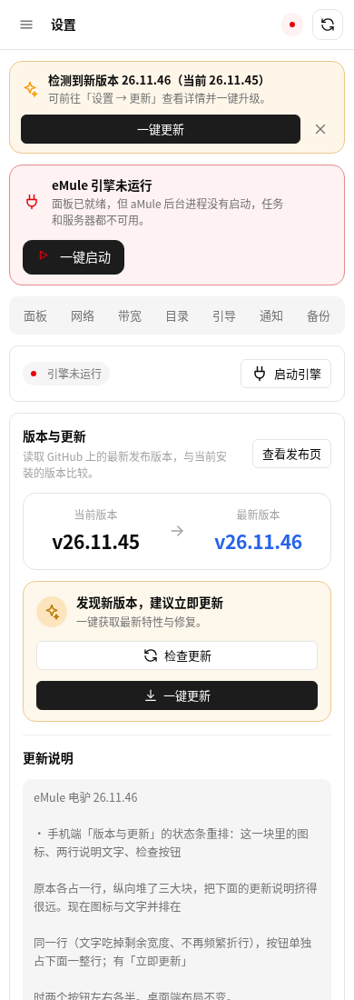

# 26.11.46 手机端更新状态条重排

## 问题

手机端「设置 → 更新」里的状态条，图标、两行说明文字、检查按钮各占一行，
竖向堆了三块，把下面的更新说明挤得很远。

根因在 style.css 的手机断点里：

```css
.vstext { flex: 1 1 100%; order: 2; }   /* 文字强制占满整行 */
```

`flex-basis: 100%` 让文字吃掉整行宽度，图标与按钮只能各自换行。

## 修法

```css
.vsic   { order: 1; }
.vstext { flex: 1 1 0; order: 2; min-width: 0; }   /* 吃掉剩余宽度，与图标同行 */
.vstatus .btn.sm { order: 3; flex: 1 1 100%; }     /* 按钮独占下一行 */
.vstatus .btn.sm + .btn.sm { flex: 1 1 0; }       /* 两个按钮时左右各半 */
```

## 踩到的两个坑（记录备查）

**1. 零高整行宽的占位元素断不了行**

先试过插一个 `.vbreak { flex: 0 0 100%; height: 0 }` 来强制换行，实测无效——
flex 布局里同 order 的项仍会被塞进当前行后再折行。改成直接给按钮设
`flex-basis: 100%` 才真正换行。

**2. `--dump-dom` 完全忽略 `--window-size`**

用 `--dump-dom` 量手机布局，报告 `innerWidth=780` / `matches640=false`，
根本没进手机断点，量到的是桌面布局。要断言手机端表现必须用 `--screenshot`，
或把测量结果写进页面再截图读回来。

## 实测（390×900 截图内注入测量）

| 指标 | 修前 | 修后 |
| --- | --- | --- |
| 图标 top | 29 | 17 |
| 文字 top | 25 | 13 |
| 按钮 top | 30（与图标同行） | **67（独占一行）** |
| 状态条高度 | 80px | 112px（含多出来的一行按钮） |
| 文字宽度 | 347px（被图标挤成窄列） | 占满剩余宽度，两行说明不再断成三行 |

桌面端（1400×900）复测：图标、文字、按钮仍在一行，布局未受影响。

## 有新版本时的实际效果（手机端）

截图来自真实数据：临时起一个 26.11.45 的面板，让它真的去查 GitHub Release，
查到的就是 26.11.46。图里那张「引擎未运行」的红卡是临时面板用
`EMULE_NO_SERVICE=1` 跳过引擎加载导致的，正常安装的面板不会出现。

**概览页顶部的更新横幅**



**设置 → 更新**



状态条渲染结果：

```
┌─────────────────────────────────────┐
│ ✨  发现新版本，建议立即更新        │
│     一键获取最新特性与修复。        │
│                                     │
│ ┌─────────────────────────────────┐ │
│ │      ↻ 检查更新                 │ │
│ └─────────────────────────────────┘ │
│ ┌─────────────────────────────────┐ │
│ │      ↓ 一键更新                 │ │
│ └─────────────────────────────────┘ │
└─────────────────────────────────────┘
```

图标与两行文字同一行，两个按钮并排占满下一行。

## 质量闸门

- JS 语法检查：app.js / i18n.js / api.js 通过
- `build_fpk.py`：py_compile + 结构检查通过
- `verify_fpk.py`：version=26.11.46、platform=all、结构完好
- 装到 fnos-test 后 `/api/health` 返回 26.11.46，引擎正常运行