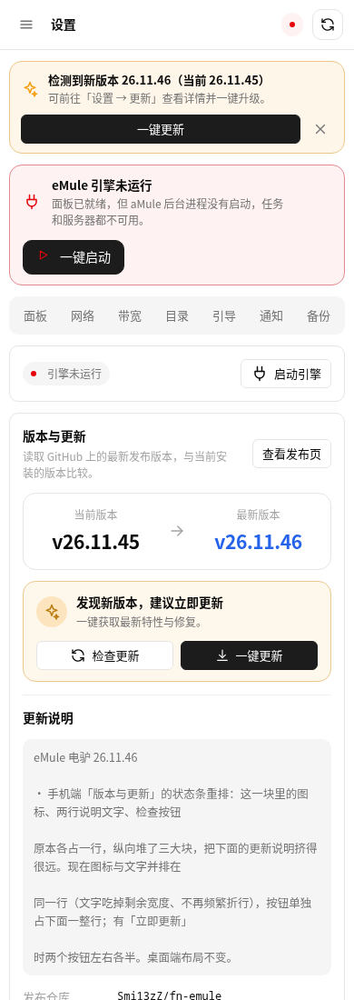
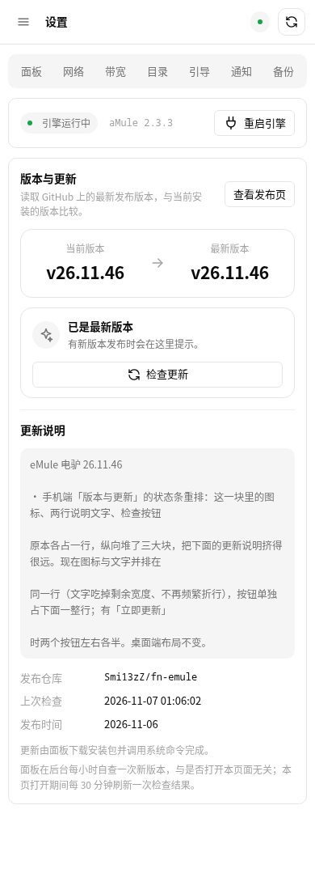

# 26.11.47 手机端更新按钮并排

## 问题

26.11.46 把按钮整块挪到状态条下面一整行时，「检查更新」和「一键更新」各占一行，
纵向又长回来一截。

## 修法

给两个按钮包一层 `.vactions`：

```css
/* 桌面端：这一层不参与布局，按钮直接排在文字右边 */
.vactions { display: contents; }

/* 手机端：这一层独占一行，内部两个按钮左右均分 */
@media (max-width: 640px) {
  .vstatus .vactions { display: flex; order: 3; flex: 0 0 100%; gap: 8px; }
  .vstatus .vactions .btn { flex: 1 1 0; min-width: 0; }
}
```

`display: contents` 是关键：桌面端这一层不生成盒子，两个按钮仍旧是
`.vstatus` 的直接 flex 项，位置与加这层之前完全一致。

## 三种情况实测（390×900）

| 场景 | 结果 |
| --- | --- |
| 有更新（两个按钮） | 并排各占一半 |
| 已是最新（只有一个按钮） | 拉满整行 |
| 桌面端（1400×900） | 按钮仍跟在文字右侧一行，未受影响 |

有更新时：



已是最新版本时：



## 质量闸门

- JS 语法检查：app.js / i18n.js / api.js 通过
- `build_fpk.py` / `verify_fpk.py`：version=26.11.47、platform=all、结构完好
- 装到 fnos-test：`/api/health` 返回 26.11.47，引擎正常运行