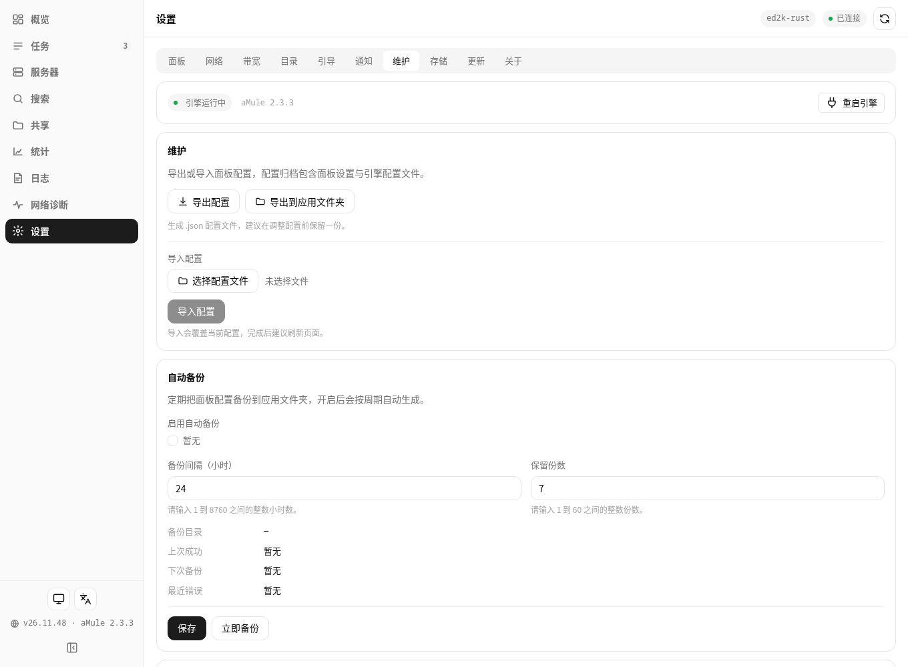
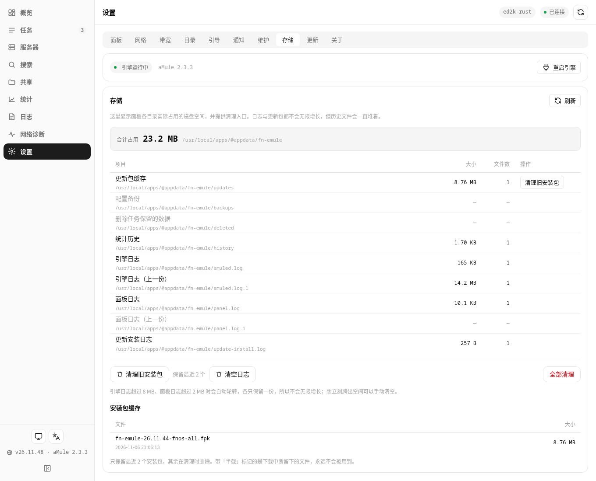
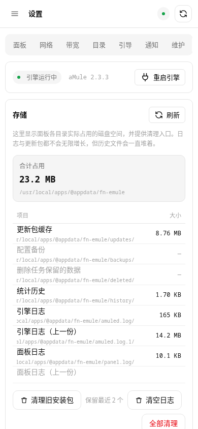

# 26.11.48 自动清理与维护/存储验证

- 更新装完自动清理安装包：新版本启动后台按「保留最近 2 个、删所有 .part/.tmp、当前版本永不删」清一次。
- 设置页：「维护 / 存储」改名「存储」；「备份」改名「维护」并补成导出/导入配置、自动备份、可用备份三块。
- 自动备份保留的是**份数**（1–60），周期为小时；导出/导入配置走 JSON，备份列表恢复走原有 tar.gz
  （含 amule.conf / server.met / nodes.dat）。

## 实机验证（fnos-test）
- 覆盖升级到 26.11.48，status running；/api/maintenance/storage 与 /api/backup/status 均返回新字段。
- 自动清理：updates/ 种下旧 .fpk + .part + .tmp，重启后日志「删除 2 个历史安装包/临时文件」，
  .part/.tmp 被清、完整包按规则保留。
- 清理 API POST logs 回收 15 MB；老版本 26.11.47 面板对真实 Release 查更新 has_update=true。
- 截图：维护页、存储页桌面、存储页手机（390px）渲染正常。

