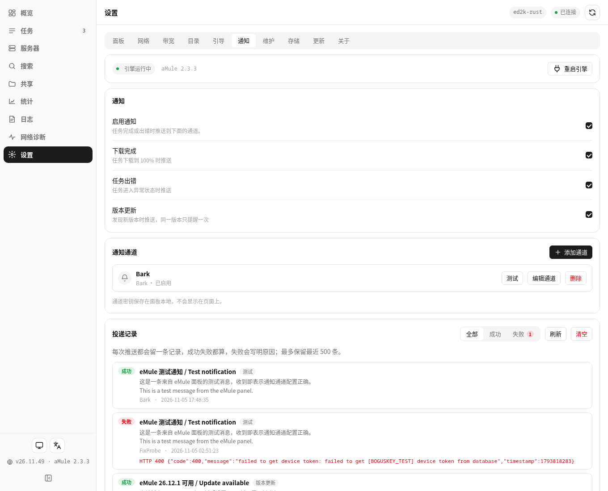

# 26.11.49 通知页投递记录

- 通知页新增**投递记录**卡片：每次推送（下载完成、任务出错、发现新版本、测试、手动）都会留一条，
  成功失败都记，失败写明原因；支持全部 / 成功 / 失败筛选（失败数徽章）、刷新与清空；
  最多保留 500 条；只存本机 `history/notify-log.json`，含标题与正文，**不含渠道密钥**。
- 后端：新增 `GET /api/notify/log`（`{ok, records, total, max}`，支持 `?limit=`）与
  `DELETE /api/notify/log`（清空）。记录写入沿用原有的 `send_channels`。

## 验证（fnos-test）
- 覆盖升级到 26.11.49，status running；`tools/check_structure.py` 与 `node --check` 全过。
- i18n：zh/en 各 699 键完全对齐，新增 20 个 `notifyLog.*` 键（含 event.error）。
- 端到端：预置含失败记录后 GET 能读回、字段齐全、无密钥；POST 返回 405；DELETE 清空生效。
- 旧版本 26.11.48 面板对真实 Release 查更新 has_update=true。

